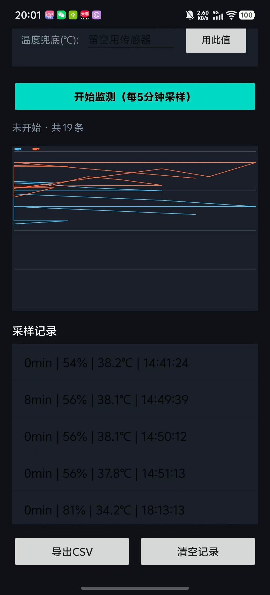
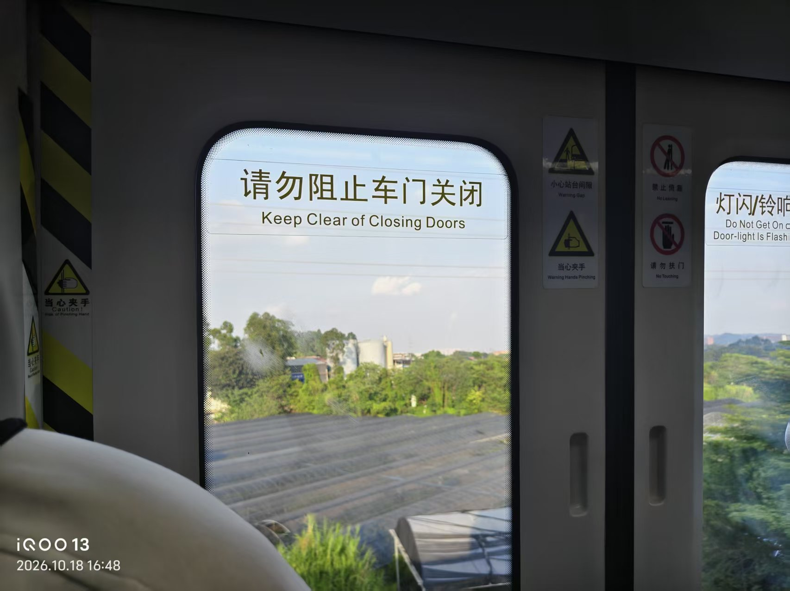
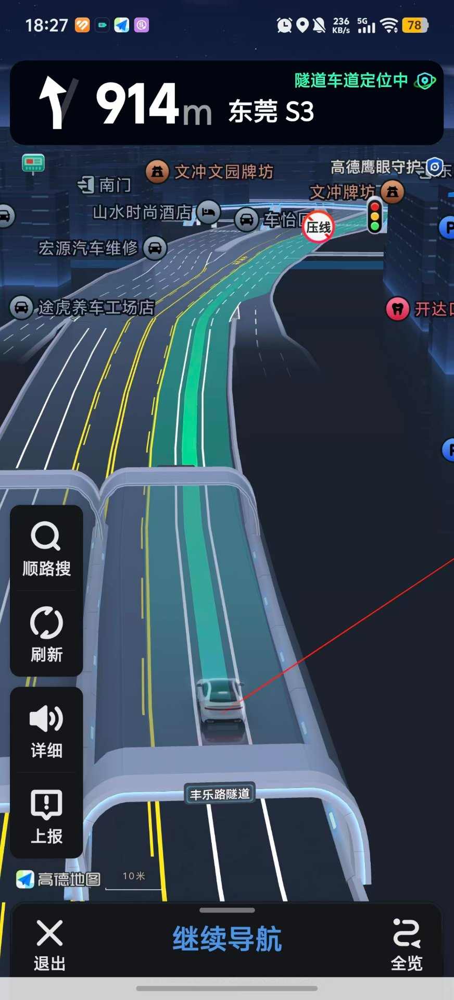
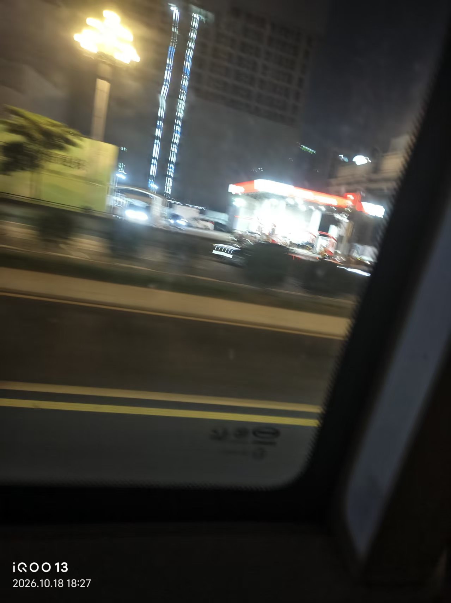
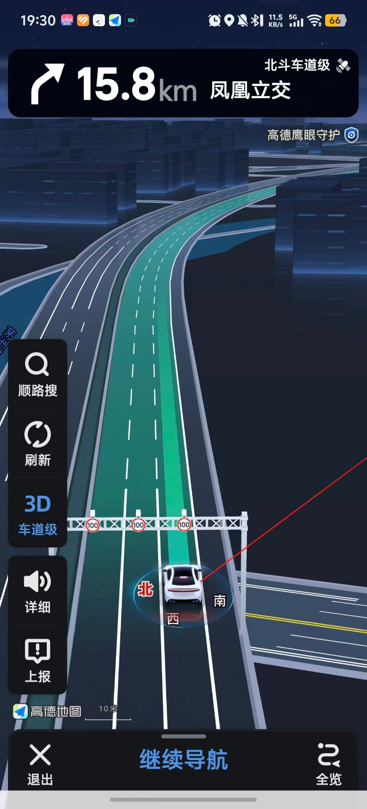

# 课题 02 · 个人手机多工况发热与掉电实测

> 原始数据：raw_data/课题02-手机发热/发热掉电原始记录.csv（24 行模板）
> 同框照：photos/课题02/（4 张：每工况 1 张本人 + 场景）
> 占分点：24 组时间序列 + 折线图 + 高功耗硬件模块分析 + 系统省电策略

## 一、课题背景与目的

- 背景：智能手机在日常使用中普遍面临"发热"与"续航焦虑"。不同使用场景（刷短视频、导航拍摄、打游戏）对硬件负载差异很大，但普通用户很难直观知道"到底哪个操作最费电、最烫手"。本课题希望用可量化的实测数据，把这种模糊的体感变成看得见的曲线。
- 目的：在 4 种典型工况下连续 30 分钟、每 5 分钟记录一次电量(%)与机身温度(℃)，共 24 组数据；通过折线图对比各工况的掉电速率与升温幅度，定位高功耗硬件模块，并据此提出可落地的系统级省电与散热策略。

## 二、采样方案

- 测试机型：iQOO 13（依素材水印确认）；电池容量 6150 mAh；系统版本【待填，例：Android 15 / OriginOS 5】
- 测试工具：本课题使用自研安卓 App「发热掉电监测」自动记录电量%与电池温度（见仓库 `02-20Days-Challenge/src/BatteryHeatMonitor`），每 5 分钟采样一次；同框照用手机原相机拍摄。【若用手动测温 App 或红外测温枪，在此注明】
- 4 种工况定义：
    1. 待机：亮屏静止，不运行大型应用
    2. 短视频：连续刷短视频 App（如抖音 / B站）
    3. 导航 / 拍摄：打开地图导航 或 连续拍摄录像
    4. 高帧率游戏：运行高画质 / 高帧率手游 30 分钟
- 采样方法：每种工况连续 30 分钟，**每 5 分钟**记录一次电量(%)与机身温度(℃)，
  时间点取 5 / 10 / 15 / 20 / 25 / 30（min），4 工况 × 6 = **24 组**
- 注意：每次测试前手机电量建议从同一起点（如 100%）开始，并记录室温

## 三、原始数据

- 逐行填写 raw_data/课题02-手机发热/发热掉电原始记录.csv
- 提交时 CSV **原样保留**，不要手动美化或四舍五入到看不出趋势

## 三·附、现场素材（photos/课题02/）

> 以下为已归档的过程素材；本人同框认证照（每工况 1 张本人 + 场景）按课程要求补齐。

### App 采样记录（导航工况，2026-10-18 共 19 条）

### 10-18 导航出行过程照

### 导航录屏（S86 深圳外环，距麻涌 10km，全程 120km / 1h42m）

## 四、数据处理与图表（Excel / WPS，零编程）

1. 打开 CSV → 全选 → 菜单「插入 → 折线图」
2. 横轴：时间(min)；纵轴：电量(%) 与 机身温度(℃)，建议画两张图分别看，或用双纵轴
3. 4 条折线分别代表 4 种工况，对比掉电斜率与升温幅度
4. 把图截图贴到本节，并标注哪条线最陡 / 最高

## 五、高功耗硬件模块分析（核心得分点）

> 以下为示例分析框架，请把【】中的结论替换为你自己的实测结果。

- 掉电最快工况：【例如"高帧率游戏"，30 分钟掉电约 X%】
- 升温最高工况：【例如"导航/拍摄"或"高帧率游戏"，峰值温度约 X℃】
- 各工况功耗归因（典型规律，需结合自身数据修正）：
    1. **待机**：主要耗电来自基带待机与屏幕常亮（若亮屏），CPU 几乎休眠，温度最低。
    2. **短视频**：屏幕（高亮度）+ 视频解码（GPU / 编解码器）+ 持续联网（Wi‑Fi / 5G 基带），中等负载，温度居中。
    3. **导航 / 拍摄**：同时拉起 GPS（持续定位）、摄像头（感光 + ISP 运算）、屏幕与基带，多模块并发，升温明显、掉电偏快。
    4. **高帧率游戏**：CPU 大核 + GPU 满负载渲染高画质高帧率画面 + 屏幕高刷 + 基带，是综合功耗与发热的最高峰，掉电最快、温度最高。
- 结论：结合第四节折线图，**掉电斜率最陡的是【____】工况，温度曲线最高的是【____】工况**；实际最突出的高功耗硬件为【GPU / CPU / 屏幕 / 基带 / 摄像头 / GPS 中实际最突出的 1–3 项】。

## 六、系统级省电策略

> 应与第五节定位到的高功耗硬件一一对应：哪块硬件最费电，就针对性地限制它。

1. **降低屏幕亮度 / 开启自动亮度**：屏幕是亮屏场景下的耗电大户，亮度每降一档可明显延长续航，也能减少整机发热。（预期：亮屏场景续航 +10%~20%）
2. **限制高帧率与高画质**：游戏内把帧率从 120Hz 降到 60Hz、画质调中，可大幅削减 GPU 负载，是降温最直接的一招。（预期：游戏工况温度 −3~5℃，掉电速率明显下降）
3. **弱信号时关 5G 用 4G / 开飞行模式**：信号差时基带会加大发射功率搜网，反而更费电更热；稳定 Wi‑Fi 环境下优先用 Wi‑Fi。（预期：弱信号待机 / 视频场景掉电减缓）
4. **限制后台刷新与冻结闲置 App**：关闭不必要的后台定位、自启动与刷新，减少 CPU 与基带空转。（预期：待机与日常使用续航提升）
5. **散热习惯**：避免"边充边玩"（充电 + 放电叠加，发热翻倍）；摘掉过厚保护壳辅助散热；高温环境（如夏天车内）尽量减少高负载游戏。（预期：峰值温度可控，延长电池寿命）

## 七、反思与改进

- 不足：仅一台手机、单次采样，可能存在个体差异与偶然误差；室温未严格控制，会影响温度读数。
- 改进：多机型横向对比、每工况多次采样取平均、记录并控制环境温湿度，结论会更稳健。
