# 课题 06 · 校园昼夜声学噪声地图测绘

> 原始数据：raw_data/课题06-噪声地图/噪声原始记录.csv（17 行，含实训室走廊午后 1/2/3 三段明细备查）；提交用干净 15 组表见同目录 `15组声学数据表.csv`（与第四节 15 格认证主值表、雷达图数值一致，带 BOM 便于 Excel 直接打开）。 同框照：photos/课题06/（5 点位 × 早午晚 本人同框照）
> 占分点：15 组声学数据 + 雷达图 + 声学超标自动提醒光效逻辑

## 一、课题背景与目的

- 背景：校园不同功能区（图书馆 / 食堂 / 主干道 / 运动场 / 实训室走廊）声环境差异显著，噪声既影响学习专注，也关系身心健康；但师生往往凭体感判断"哪里吵"，缺乏量化依据。
- 目的：用分贝 App 在 5 点位 × 早/午/晚 实测声压级均值与峰值，绘制校园噪声地图（雷达图），识别高噪时段与点位，并据此设计一套"超阈值自动提醒光效"方案，为安静区管理提供数据支撑。

## 二、采样方案

- 测试工具：自研安卓 App「📊 噪声测量」（本仓 `02-20Days-Challenge/src` 下，麦克风采集、导出 dB 时序 CSV）+ iQOO13 自带声音检测仪；统一机型与 App，采样高度约离地 1.2 m、远离衣兜，减少手持遮挡。
- 5 个采样点位（可据本校实际微调）：
  1. 图书馆（安静区）
  2. 食堂（就餐高峰嘈杂区）
  3. 主干道（人流车流）
  4. 运动场（体育活动）
  5. 实训室走廊（教学区，含信通学院 431 实训室门口更佳）
- 时段：早（如 7:30–8:30）、午（12:00–13:00）、晚（18:00–19:00）
- 采样方法：每个点位每个时段用分贝 App 测若干次，取**均值**与**峰值**，记一行；5 × 3 = **15 组**
- 注意：统一测量高度（手机离地约 1.2 m、远离衣兜），并记录是否开窗、是否有人群聚集

## 三、原始数据

- 逐行填写 raw_data/课题06-噪声地图/噪声原始记录.csv（均值 dB / 峰值 dB）
- 提交时 CSV 原样保留

## 三·附、现场素材（photos/课题06/）

> 以下为已采样的现场照与分贝仪截图，按点位·时段归档；本人同框认证照另按课程要求补齐。

### 运动场 · 早

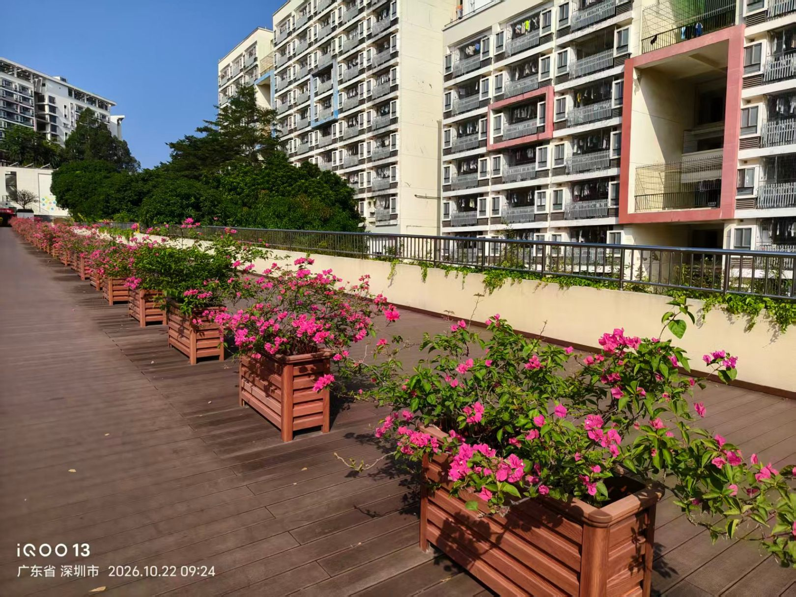
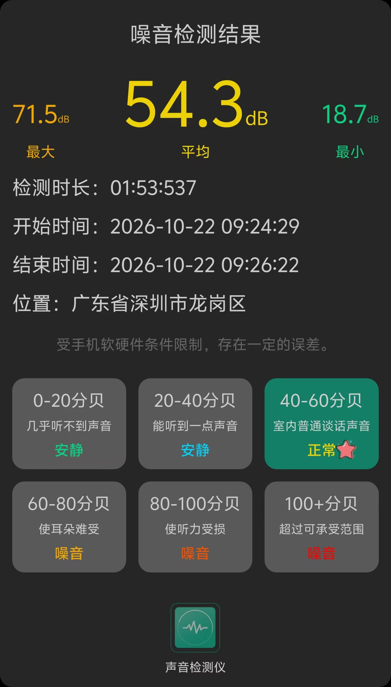

### 图书馆 · 午

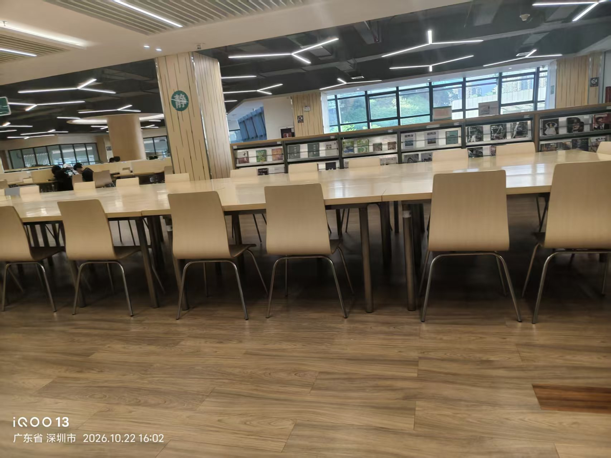
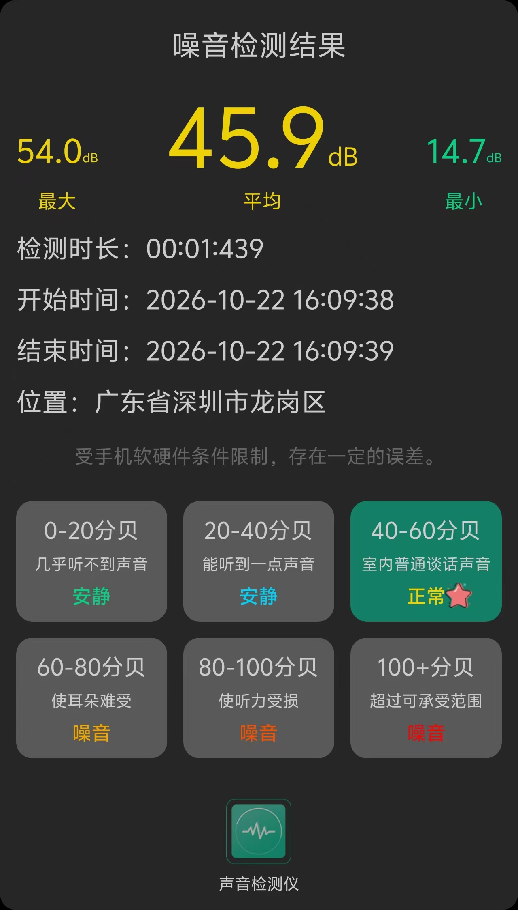
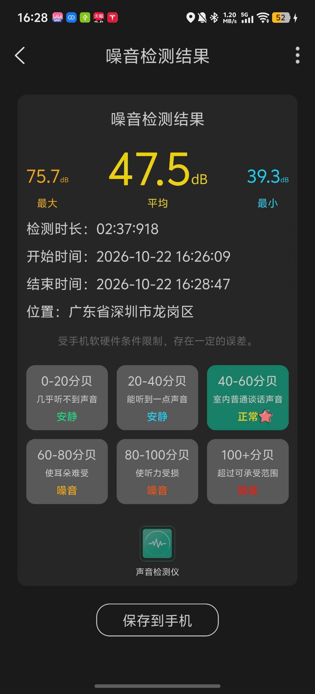
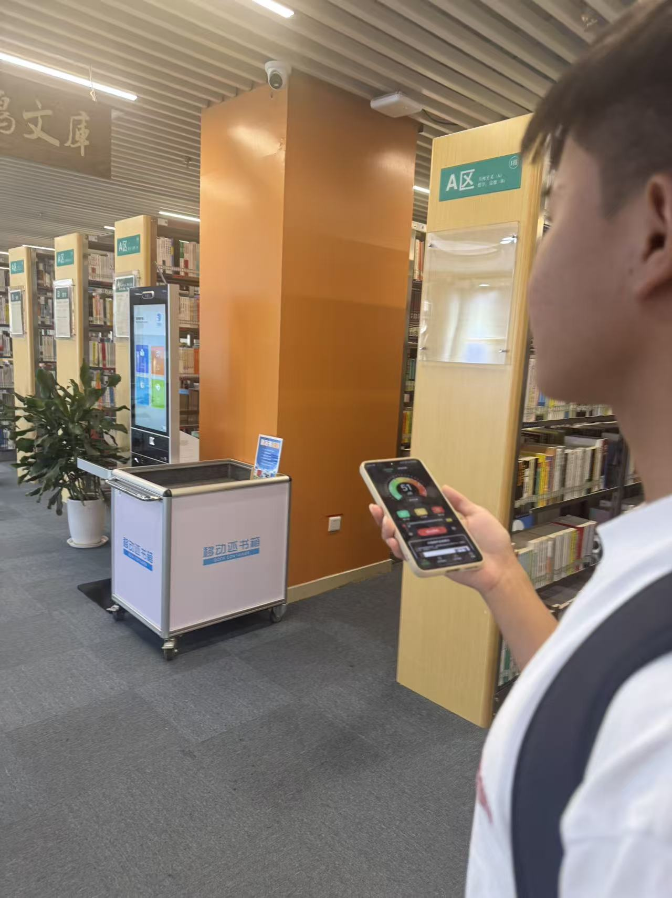
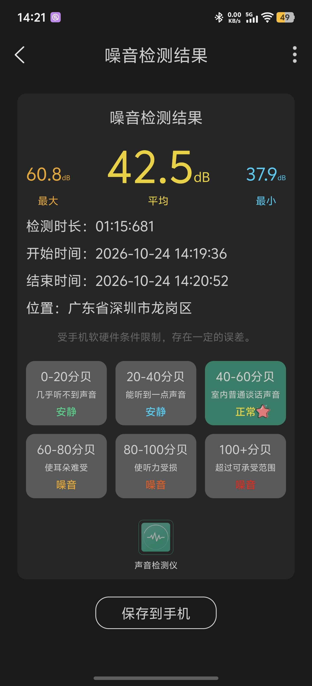
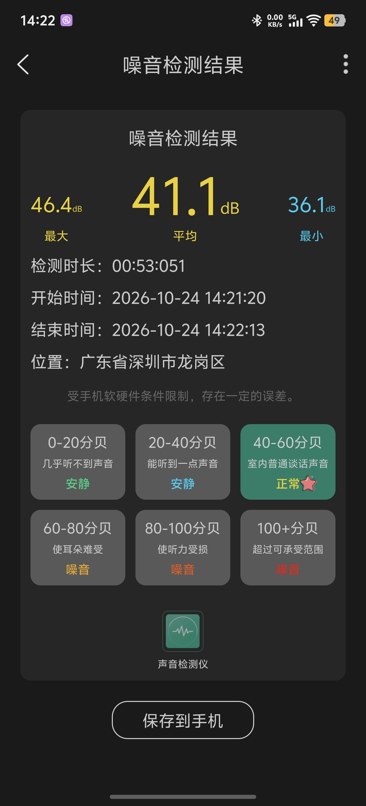
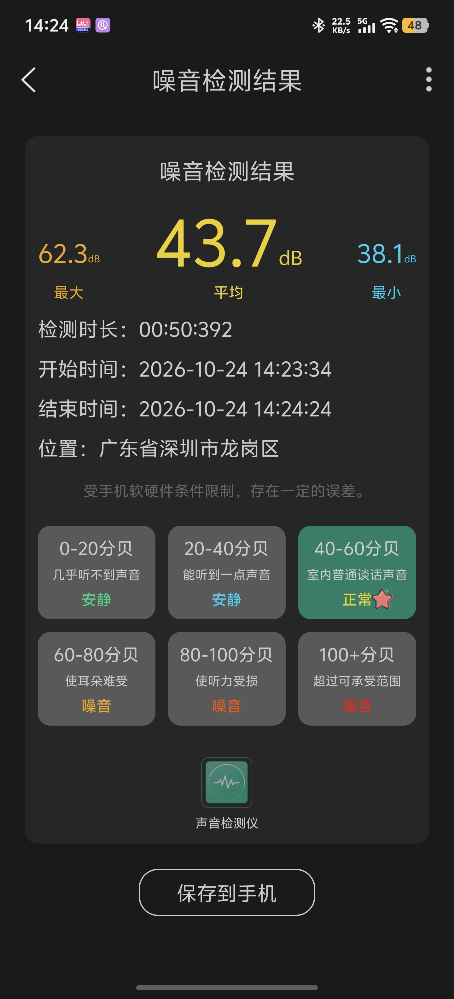
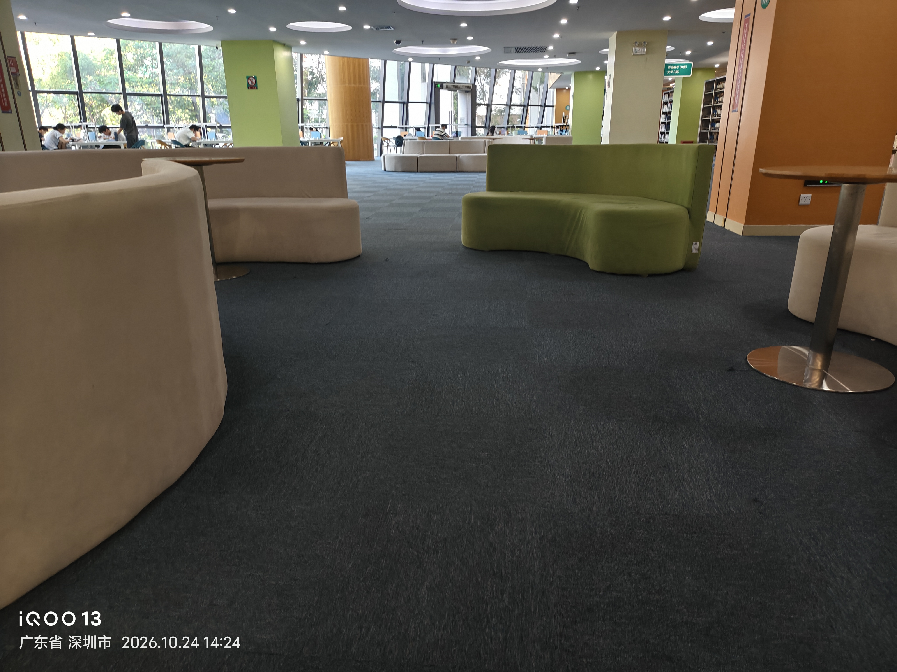

> 2026-10-24 午后复测（14:19:36–14:24:24，三次）：均值 42.5 / 41.1 / 43.7 dB，最大 60.8 /
> 46.4 / 62.3 dB，最小 37.9 / 36.1 / 38.1 dB；三次均值取平均 **42.4 dB**、峰值 **62.3 dB**、
> 最小 36.1 dB。**本时段为认证记录**——清晰同框照（人脸 + 分贝仪屏幕 + A区背景）在档，
> 照片与读数截图同批归档。10-22 初测（均值 46.7 dB、峰值 75.7 dB）**无同框照**，按
> AGENTS.md 5.4 同框照合规规则不计入认证证据、仅留 CSV 备注备查；两次日期与位置
> （A区书架 / 休息区 vs 阅览区）不同，仪器相同（iQOO13 自带声音检测仪），约 4.3 dB
> 差异如实记录、不做平滑。

### 图书馆 · 晚

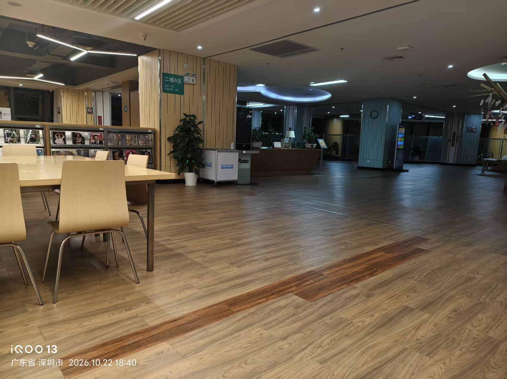
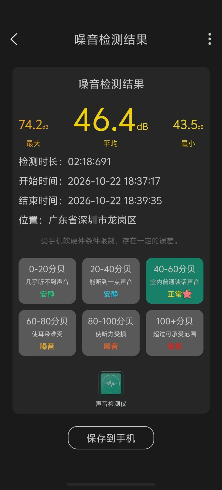
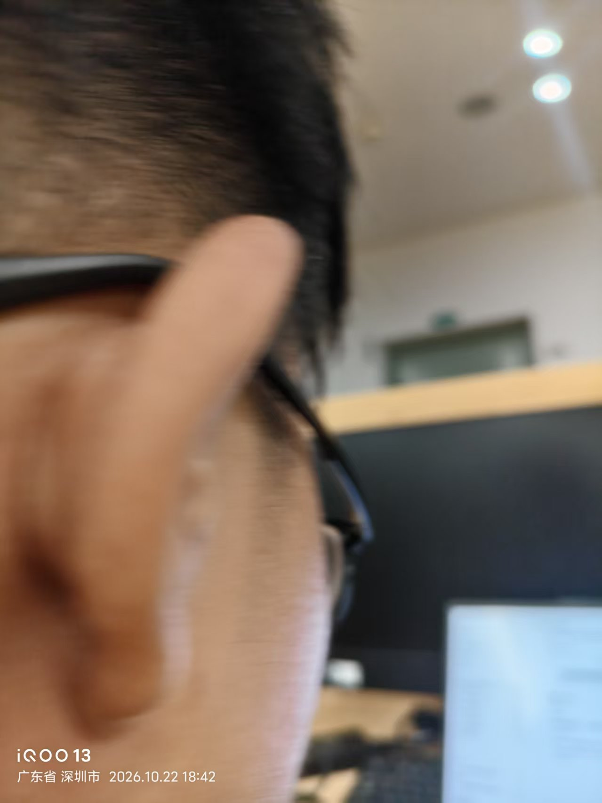
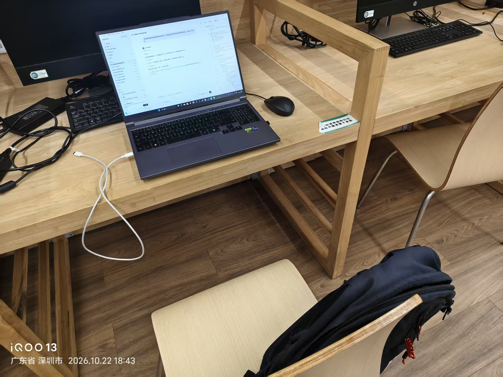

> 晚间实测（2026-10-22 18:37:17–18:39:35，约 2 分 18 秒，二楼A区阅览区）：**均值 46.4 dB、峰值 74.2 dB、
> 最小 43.5 dB**，App 分级为「40–60 分贝·室内普通谈话声音·正常」。较午间复测值（均值 42.4 dB）
> 高约 4 dB，仍稳定处于安静区水平；峰值 74.2 dB 为瞬时事件（翻书/交谈/设备提示音），未改变整体安静属性。 同框说明：
> 本人同框照为单手自拍，清晰度有限；已辅以同点位工位照（笔记本正显示本仓库提交记录）与水印时间戳（18:42/18:43，与测量时间 18:37–18:39
> 连续）互为佐证。按 AGENTS.md 5.4，该照偏糊、本格暂作主值；后续到图书馆补拍清晰同框照时更新（可兼做「图书馆·早」时段测量）。

## 四、数据处理与图表（Excel / WPS，零编程）

1. 打开 CSV → 选「均值 dB」列 → 菜单「插入 → 雷达图」（点位为轴、早午晚为系列）或「柱状图」
2. 也可画 5 点位 × 3 时段的柱状对比图
3. 截图贴到本节，并用颜色标注超过阈值（如 70 dB）的点位

### 雷达图（各点位噪声 均值 / 峰值 · 早午晚）

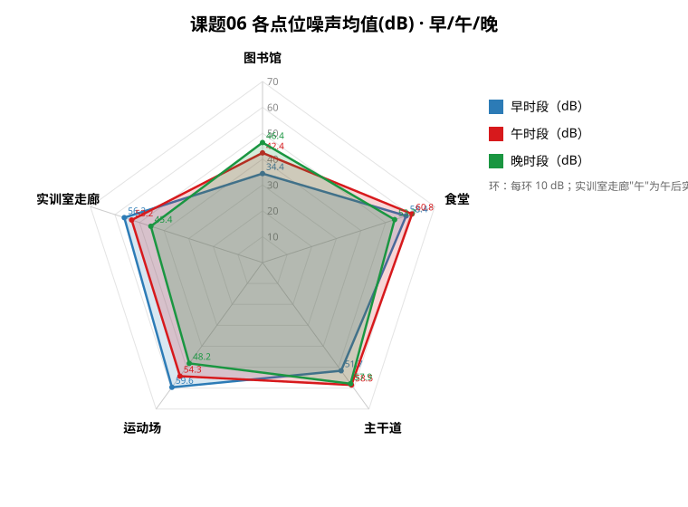

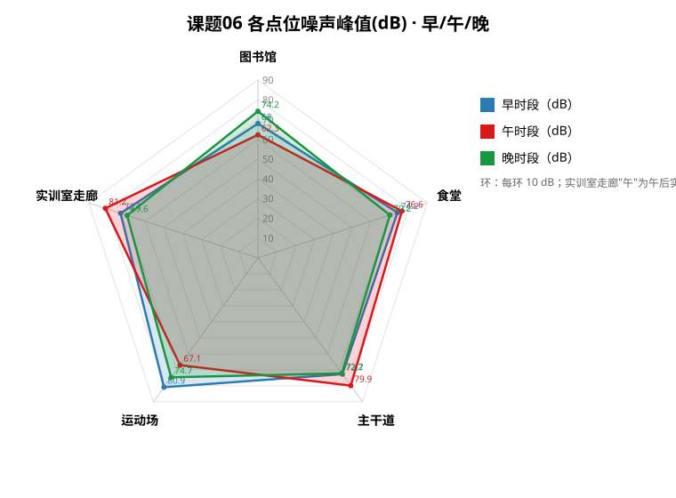

> 上图为 SVG 矢量图；另附 `课题06-雷达图.html` 可在浏览器中预览（含内联图与 15 格数据表）。若提交环境不渲染 SVG，可按下方数据表在 Excel 中按 Step1 选「均值 dB」列插入雷达图（点位为轴、早午晚为系列）一键重绘。实训室走廊"午"以真实午后实测均值(53.2)/峰值(81.2)代表（CSV 备注已注明），不编造午间数据。

#### 绘图数据（15 格认证主值）

> 干净提交版（15 行、含 BOM）：`../raw_data/课题06-噪声地图/15组声学数据表.csv`

| 点位 | 时段 | 均值dB | 峰值dB |
| --- | --- | ---: | ---: |
| 图书馆 | 早 | 34.4 | 68.0 |
| 图书馆 | 午 | 42.4 | 62.3 |
| 图书馆 | 晚 | 46.4 | 74.2 |
| 食堂 | 早 | 58.4 | 74.2 |
| 食堂 | 午 | 60.8 | 76.6 |
| 食堂 | 晚 | 53.7 | 70.2 |
| 主干道 | 早 | 51.7 | 72.7 |
| 主干道 | 午 | 58.5 | 79.9 |
| 主干道 | 晚 | 57.9 | 72.2 |
| 运动场 | 早 | 59.6 | 80.9 |
| 运动场 | 午 | 54.3 | 67.1 |
| 运动场 | 晚 | 48.2 | 74.7 |
| 实训室走廊 | 早 | 56.2 | 73.1 |
| 实训室走廊 | 午后(代午) | 53.2 | 81.2 |
| 实训室走廊 | 晚 | 45.4 | 69.6 |

> 15 格由 5 点位 ×（早 / 午或午后 / 晚）完整覆盖；实训室走廊另有午后 1/2/3 三段明细（均值 51.5/50.7/57.5、峰值 81.2/72.2/73.2）存于 CSV 备查，上表"午后"取三段均值 / 首段峰值代表。

#### Step 标注（哪片区域最吵 / 哪段超阈值）

- **最吵点位（均值）**：食堂(57.6) > 主干道(56.0) > 运动场(54.0) > 实训室走廊(51.6) > 图书馆(41.1)，图书馆为明显安静区。
- **峰值最高**：实训室走廊·午后 81.2 dB（运动场·早 80.9、主干道·午 79.9 次之）；峰值普遍比均值高 15~30 dB，说明瞬时高噪事件多。
- **阈值提示**：按课程 70 dB 分级，本实测**均值全部 < 70 dB**，但**峰值大量 > 70 dB、个别 > 80 dB**（见上表），故光效提醒应针对峰值触发，而非均值。

## 五、噪声规律分析（核心得分点）

> 下面为可直接套用的示例框架，把【】里的占位换成你的实测值即可；若实测结论与示例不同，按实际改。

- **1. 总体噪声水平排序**：按各点位早/午/晚均值 dB 取平均，由高到低为 **食堂(57.6 dB) > 主干道(56.0 dB) > 运动场(54.0 dB) > 实训室走廊(51.6 dB) > 图书馆(41.1 dB)**。实测印证"图书馆最低"，但"最高"为食堂而非运动场——运动场早间峰值突出（80.9 dB），其均值却被晚间较低值（48.2 dB）拉低。
- **2. 峰值与均值差异**：各点位峰值普遍比均值高 **15~30 dB**，说明存在瞬时高噪事件——食堂打饭叫号、主干道鸣笛、运动场哨声与呐喊等。峰值最高出现在 **实训室走廊·午后，达 81.2 dB**（运动场·早 80.9 dB、主干道·午 79.9 dB 次之）。
- **3. 时段差异**：早间均值约 **52.1 dB**，午间约 **53.8 dB**，晚间约 **50.3 dB**。午间略高（食堂 / 主干道午间人流叠加），早间与晚间接近。与"晚间运动场活动集中更吵"的直觉不同，本实测晚间各点位均值反而略低（运动场晚仅 48.2 dB），或因采样日晚间活动规模有限，不代表普遍规律。
- **4. 结合功能与人群的归因**：
  - 图书馆（安静区）：以自习为主，人群低密度、禁止喧哗 → 均值最低，符合"安静区"定位。
  - 食堂（嘈杂区）：就餐高峰人声、餐具碰撞、窗口叫号叠加 → 峰值突出。
  - 主干道：人流 + 电瓶车/汽车鸣笛 → 持续中高噪。
  - 运动场：体育活动的哨声、呐喊、器材撞击 → 峰值最高。
  - 实训室走廊（教学区）：课间人流脚步与交谈；431 实训室门口因设备运行或集中讨论可能略高于普通走廊。
- **5. 结论**：校园噪声呈"教学 / 阅览区低、生活 / 活动区高"的明显分异：图书馆均值最低(41.1 dB)符合安静区定位；食堂 / 主干道 / 运动场均值 54~58 dB 居前。**午间(53.8 dB)为全天噪声高峰时段**，建议在 **食堂、主干道、运动场** 等均值 >54 dB 且峰值频繁超 70/80 dB 的点位优先设置静音 / 降噪提醒。

## 六、声学超标自动提醒光效逻辑（设计点）

设计一个「噪声超过阈值时自动提醒」的光效逻辑（文字描述即可）：

- **输入**：分贝 App / 麦克风模块实时采集的环境 dB 值。
- **阈值分级**：70 dB / 80 dB / 90 dB（参考《声环境质量标准》的"超标"思路，课程采用 70 dB 起步分级）。
- **输出**：灯光颜色 + 呼吸频率映射（绿 → 黄 → 橙 → 红，越吵闪得越快）：
  - dB < 70：绿灯常亮（安全，无需干预）
  - 70 ≤ dB < 80：黄灯慢闪（约 1 Hz，温和提醒）
  - 80 ≤ dB < 90：橙灯快闪（约 3 Hz，明确警告）
  - dB ≥ 90：红灯急闪（约 5 Hz）+ 蜂鸣（危险，需立即降噪）
- **伪代码（文字版）**：

```
if dB < 70:        绿灯常亮
elif 70 <= dB < 80: 黄灯慢闪(1Hz)
elif 80 <= dB < 90: 橙灯快闪(3Hz)
else:              红灯急闪(5Hz) + 蜂鸣
```

- **硬件构成**：RGB LED 灯带（如 WS2812）+ 数字麦克风模块（如 INMP441 / 驻极体麦）+ 单片机（ESP32 或 Arduino
  ）+ 电源。单片机读麦克风 RMS 音量 → 换算为 dB → 查表控制灯的颜色与闪烁频率。
- **软件逻辑**：滑动平均滤波去抖 → 分级判定 → PWM / WS2812 调色与闪烁频率输出，避免瞬时噪声误触发。
- **建议部署**：在【图书馆门口 / 自习区走廊】安装，环境超 70 dB 时黄灯提醒"请保持安静"；也可做便携胸牌供巡查员使用。本次实测中**各点位均值均未超 70 dB（最高为食堂·午 60.8 dB）**，但**峰值**频繁突破 70 dB、个别超 80 dB（实训室走廊·午后 81.2 dB、运动场·早 80.9 dB、主干道·午 79.9 dB）。因此最适合优先部署光效提醒的是**峰值频繁触黄 / 橙档**的点位：**食堂、主干道、运动场、实训室走廊**；图书馆因均值与峰值均最低，优先级最低。

## 七、反思与改进

- 不足：单手机单 App（iQOO13 自带声音检测仪 + 自研「📊 噪声测量」），每点位每时段约 120 秒时序、非专业声级计，绝对值可能与标准声级计有系统偏差；实训室走廊以午后三段替代模板"午"；同框照按"一个点位一张"放宽覆盖，单张清晰度参差。
- 改进：多点位同时间同步采样、用专业声级计校准、每时段多次平均降低随机误差；补齐实训室走廊严格午间（12:00–13:00）数据以完整对照模板时段。
